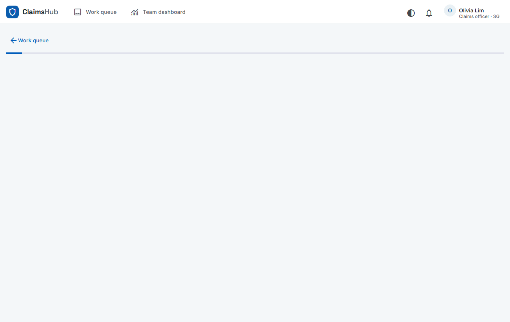

# Claims Hub — Insurance Claims Management Platform

Motor and property claims for six APAC markets (SG, HK, AU, MY, TH, ID). Policyholders report incidents and track
them. Claims officers pick up, assess, approve, settle or reject claims. Managers see liability exposure and team
workload in real time. One Angular application serves all three roles.

**Stack:** Java 17 · Spring Boot 3.4 · Spring Cloud 2024 (Gateway, Eureka, Resilience4j) · Kafka · PostgreSQL 16 ·
Angular 22 with Native Federation micro-frontends · Angular Material 3 · JWT · Maven · Docker Compose.

| Document | What it covers |
|---|---|
| [docs/ARCHITECTURE.md](docs/ARCHITECTURE.md) | High- and low-level design, service boundaries, REST vs Kafka, data model, API, events, security, decisions |
| [docs/claims-flow.html](docs/claims-flow.html) | Step-by-step walkthrough: what is synchronous, where Kafka is used, which tables change (open in a browser) |
| [docs/IMPLEMENTATION_PLAN.md](docs/IMPLEMENTATION_PLAN.md) | Phases, test strategy and their status |
| [docs/MANUAL_TEST_GUIDE.md](docs/MANUAL_TEST_GUIDE.md) | Step-by-step manual tests: DBeaver connection, Kafka UI, what to click, which rows and events to check |
| [docs/AI_JOURNAL.md](docs/AI_JOURNAL.md) | How the AI was directed, challenged and overridden |
| [contracts/](contracts) | OpenAPI spec of each service and the JSON Schema of the Kafka event |



---

## Repository layout

```
claims-management-platform/
├── backend/                     6 independent Spring Boot services (folder only, NO parent pom)
│   ├── platform/
│   │   ├── discovery-server/    Eureka                                   :8761
│   │   └── api-gateway/         Spring Cloud Gateway, JWT, CORS          :8080
│   └── services/
│       ├── identity-service/    users, login, JWT issuance               :8081  identity_db
│       ├── policy-service/      policies, coverage, paid-to-date         :8082  policy_db
│       ├── claims-service/      claim lifecycle, queue, dashboards       :8083  claims_db
│       └── notification-service/ in-app notifications from events       :8084  notification_db
├── frontend/                    Angular 22 workspace: shell, claimant, staff, shared   :4200 / :4201 / :4202
├── contracts/
│   ├── openapi/                 exported OpenAPI spec of each service
│   └── events/                  claims.lifecycle.v1.schema.json (the Kafka contract)
├── infra/                       postgres/ init script (4 databases, 4 logins); seaweedfs/ S3 credentials
├── scripts/                     build-all.sh, e2e-smoke.mjs, verify-fresh-stack.sh
├── docker-compose.yml           whole stack, run from the repository root
└── docs/                        ARCHITECTURE.md, IMPLEMENTATION_PLAN.md, AI_JOURNAL.md, claims-flow.html, screenshots/
```

`backend/` is only a folder: each service has its own `pom.xml`, Dockerfile, database and tests, and builds on its own.

---

## Run it

Prerequisites: Docker Desktop (4 GB of memory is enough), JDK 17 or newer, Maven 3.9, Node 22 or newer.

```bash
./scripts/build-all.sh                      # builds and tests every service, then the frontend
docker compose --profile frontend up -d --build
```

The first start takes about 1–2 minutes while the services register with Eureka. Then open **http://localhost:4200**.

| URL | What |
|---|---|
| http://localhost:4200 | The application (shell). Micro-frontends are served from :4201 (claimant) and :4202 (staff) |
| http://localhost:8080 | API gateway (the only backend address the browser uses) |
| http://localhost:8761 | Eureka dashboard |
| http://localhost:8333 | Object storage for claim photos and documents (SeaweedFS, S3 API; files are only reachable through claims-service) |
| http://localhost:8089 | Kafka UI (optional: `docker compose --profile tools up -d kafka-ui`) |
| http://localhost:808{1..4}/swagger-ui.html | Swagger UI of each service, reachable from inside the Docker network (`docker exec`) or when run locally |

Faster build without tests: `./scripts/build-all.sh --skip-tests`.
Reset all data to the demo seed: `docker compose --profile frontend down -v` and start again.

On Windows behind antivirus or a proxy that inspects TLS, Maven needs the Windows certificate store:
`export MAVEN_OPTS="-Djavax.net.ssl.trustStoreType=Windows-ROOT"` (the build script sets this automatically).

### Demo accounts (password `Password1!` for all; one-click buttons on the sign-in page)

| User | Role | Notes |
|---|---|---|
| alice@claimant.test | Policyholder, SG | Motor and property policy, plus a lapsed one (try reporting against it) |
| bob@claimant.test | Policyholder, HK | |
| carol@, dev@, tara@, indra@claimant.test | Policyholders in AU, MY, TH, ID | Tara has a claim waiting for her answer |
| olivia@staff.test | Claims officer | Approval limit USD 25,000 |
| omar@staff.test | Claims officer | |
| maya@staff.test | Claims manager | Can assign, reassign and approve any amount |

Sixteen seeded claims cover every status and market, so the queue and dashboard have data on first launch.

### Run a service on its own (development)

```bash
docker compose up -d postgres kafka discovery-server       # infrastructure only
cd backend/services/claims-service && mvn spring-boot:run  # any service, defaults point at localhost
cd frontend && npm ci && npm run start:all                 # shell :4200 + remotes :4201/:4202 with live reload
```

---

## What it does

**Claimant (claimant micro-frontend)**
- Reports an incident in three steps: policy, what happened, estimated loss and review. Cover is checked straight away
  (inactive policy, incident outside the policy period, wrong product, someone else's policy).
- Sees all their claims with a plain-language status, a progress tracker, the full history and the decision.
- Answers the claims officer's questions; the claim goes back to review once every question is answered.
- Adds photos of the damage while reporting, and later photos, a police report or a repair estimate (JPEG, PNG,
  WebP or PDF, up to 10 MB) until the claim is decided.
- Withdraws a claim before it is assessed. Receives in-app notifications for every step that concerns them.

**Claims officer (staff micro-frontend)**
- Work queue with tabs (to pick up, mine, all open, search all), filters (market, priority, status, overdue, text),
  sorting, paging and SLA indicators. Picking up uses optimistic locking: if two officers click at once, one wins and
  the other is told. The queue and the manager dashboard refresh every 30 s and when the tab regains focus, and the
  "To pick up" tab shows how many claims are waiting.
- Claim workspace: incident, photos and documents (gallery with a full-size viewer), cover at the time of report,
  questions and answers, assessments, internal notes, history. The action panel offers only what the status allows:
  ask the claimant, assess (liability, recommended amount, reserve), approve (with the authority limit shown, and only
  once there is at least one damage photo), record payment, reject with a reason the claimant can read.
- Own workload figures: open, overdue, high priority, closed in 30 days, average days to close.

**Claims manager**
- Everything an officer can do on any claim, plus assigning and reassigning claims and approving above the limit.
- Dashboard: outstanding liability, paid and incurred (USD and local currency), split by market, line of business,
  status and age; team workload and performance per officer; overdue claims.

**Platform**
- REST through one gateway; Kafka for claim events (transactional outbox, events keyed by claim, duplicate-safe
  consumers, retries and dead-letter topic); circuit breakers on the two synchronous service-to-service calls.
- JWT checked at the gateway **and** in every service; role checks per endpoint; claimants can only see their own
  claims (a foreign claim returns 404); RFC 7807 errors with a correlation id everywhere.
- One PostgreSQL database and login per service, Flyway migrations, health checks, Docker Compose for everything.
- Photos and documents in S3-compatible object storage (SeaweedFS locally), checked by their content, streamed
  through claims-service with the claim's access rules, and announced on Kafka as `DocumentUploaded`.

---

## Tests (all run and passing on 16 Nov 2026)

| Suite | Count | What it proves |
|---|---|---|
| api-gateway | 5 | 401 without/forged token, `/internal/**` blocked, CORS preflight, health |
| identity-service | 9 | Login, token claims, same 401 for wrong password and unknown user, validation, role rules |
| policy-service | 15 | Coverage rules; ClaimSettled applied once even when delivered twice; malformed event → DLT |
| claims-service | 107 | All 64 status pairs of the state machine; aggregate rules; duplicate-claim rule and policy-wide payout limit; triage; circuit breaker (404 is not a failure, 5xx opens the circuit); photo and document rules (type from the file content, size, who may add and see, damage photo before approval) against real S3-compatible storage; full HTTP lifecycle with all 8 events checked on Kafka in order; 409 on concurrent pick-up; authority limit; access rules; dashboard totals |
| notification-service | 16 | Who is notified for each event (including new evidence from the claimant); exactly once per event; users only see their own |
| Frontend unit (Vitest) | 45 | Auth store, interceptor and guards; pipes; chips; every feature store; action panel rules; photo checks and the documents store |
| API smoke (`scripts/e2e-smoke.mjs`) | 38 checks | The whole business flow through the gateway against the running stack, including both Kafka consumers |
| Browser e2e (Playwright) | 6 | Claimant wizard with a photo; officer lifecycle to payment, blocked until a damage photo arrives; authority limit; manager dashboard; access; theme |

Backend integration tests use real PostgreSQL 16 and SeaweedFS (Testcontainers) and an embedded Kafka broker, so Docker must be running.

```bash
cd backend/services/claims-service && mvn verify # any service
cd frontend && npm test                         # all frontend unit tests
node scripts/e2e-smoke.mjs                      # against a running stack
cd frontend && npx playwright install chromium && npx playwright test
./scripts/verify-fresh-stack.sh                 # wipes the data, rebuilds, runs smoke and browser tests
```

---

## Known limitations and next steps

- Photos and documents: no virus scanning, image resizing or server-side thumbnails yet, and uploads go through
  claims-service (fine at 10 MB per file; presigned URLs straight to S3 would be the next step at scale). The stored
  SHA-256 could flag the same photo reused on another claim.
- Payments are recorded, not executed. Email and SMS are a logged stub behind a `NotificationChannel`.
- FX rates are static configuration. HS256 shared-secret JWT without refresh tokens; production would use an identity
  provider with RS256/JWKS.
- Frontend API types are hand-written to mirror the exported OpenAPI specs; generating them in CI is the next step.
- Notifications reach the browser by polling (30 s and on tab focus); Server-Sent Events would remove the delay.
- If policy-service is down, new claims are refused with 503 rather than accepted as "pending verification".
- The outbox relay assumes one claims-service instance; with several, rows should be claimed with
  `SELECT … FOR UPDATE SKIP LOCKED` (delivery is already at-least-once and consumers de-duplicate).
- Dashboards read a projection of the claims table; at high volume they would move to SQL aggregates or a Kafka-fed
  reporting store.
- No Kubernetes manifests or CI pipeline yet; the stack runs with Docker Compose.
