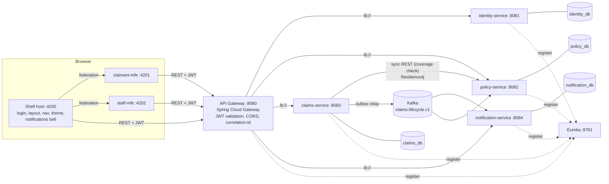
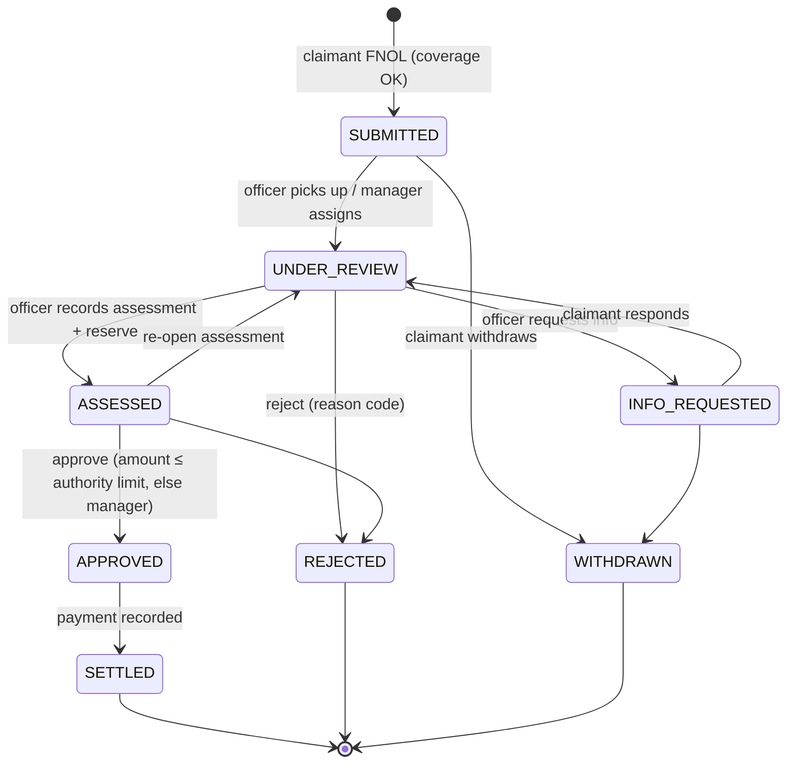
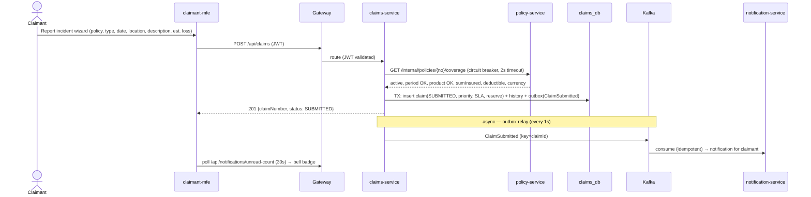

# Intelligent Claims Management Platform — Architecture (HLD + LLD)

> Source documents: `V2_FullStack_candidate_assessment_brief - FrontEnd BackEnd.docx`, `Chubb_Weekend_Drive_Java.pptx`
> (rubric slide 08). The `.mp4` could not be processed by the AI tooling and was not used as a requirement source.

---

## 1. Problem summary

APAC motor & property claims across **six markets** are handled by phone/email/spreadsheets.

| Actor | Needs (from brief) |
|---|---|
| **Claimant** | Report an incident (FNOL), track the claim, provide additional info when asked, receive decisions |
| **Claims Officer** | Pick up incoming claims, review/assess, progress to settlement or rejection, see own + team workload/performance |
| **Claims Manager** | Real-time picture of outstanding claims and **liability exposure**; team workload; approves above officer authority |

Single Angular application serves all user types.

### Rubric-driven priorities (135 pts)

| Area | Pts | How this design scores it |
|---|---|---|
| AI collaboration process | 25 | `docs/AI_JOURNAL.md` kept from the first prompt; accepted / challenged / overridden entries |
| Planning, architecture, design | 15 | This document, ADRs (§12), trade-offs stated explicitly |
| Clean architecture | 15 | Layered-by-feature packages, domain state machine free of Spring, SOLID |
| MFE architecture & components | 15 | Angular **Native Federation**: shell host + `claimant` + `staff` remotes + shared lib |
| Data & integration | 12 | DB-per-service, Flyway, transactional outbox → Kafka, idempotent consumers |
| Service & API design | 10 | Intent-based command endpoints, RFC 7807 errors, OpenAPI per service |
| Backend tests | 8 | Domain unit tests, `@WebMvcTest` + security, Testcontainers/Embedded Kafka integration |
| State mgmt / data flow | 8 | Signal-based stores per feature, unidirectional flow, typed API layer |
| Theming / a11y / UX | 8 | Angular Material M3 tokens, light/dark, WCAG AA contrast, keyboard + ARIA |
| Frontend tests | 7 | Vitest component/store tests, Playwright e2e for the two golden paths |
| Backend / frontend completeness | 5 + 7 | End-to-end flows in §8 working via `docker compose up` |

---

## 2. High-level architecture



### Services and boundaries

| Service | Type | Owns | Why it is its own service |
|---|---|---|---|
| **claims-service** | Business (core) | Claim aggregate, lifecycle state machine, info requests, assessments, decisions, internal notes, workload & exposure read models | The core domain; highest change rate; its data is the system of record for liability |
| **policy-service** | Business | Policies, coverage (sum insured, deductible, period), paid-to-date against policy | Different lifecycle (underwriting), different owners; claims needs a *read* of coverage, not ownership |
| **notification-service** | Business | Per-user in-app notifications (claimant + staff), delivery log | Pure downstream consumer; must never block or fail a claim transaction |
| identity-service | Platform | Users, roles, credentials, JWT issuance | Security concern, swappable for Keycloak/Azure AD later (ADR-005) |
| api-gateway | Platform | Routing, edge auth, CORS, `/internal/**` blocking | Single origin for the SPA |
| discovery-server | Platform | Eureka registry | Required by stack; enables `lb://` routing |

**Deliberately not split out:** documents/attachments (out of scope, ADR-009), assessment as a separate service (it shares the claim's consistency boundary — splitting would force distributed transactions over a single state machine).

---

## 3. Synchronous vs event-driven (the "REST or Kafka" decision)

| Interaction | Mechanism | Reason |
|---|---|---|
| UI ↔ any service | REST via gateway | User waits for an answer; needs validation errors immediately |
| FNOL → **coverage check** (claims → policy) | **Sync REST** (load-balanced `RestClient`, Resilience4j circuit breaker + timeout) | Claimant must be told *now* if the policy is inactive / incident outside period / wrong product. Result is **snapshotted onto the claim** so later reads never call policy-service |
| Claim lifecycle changes → notifications | **Kafka** | Fire-and-forget; notification outage must not fail a claim decision |
| Claim settled → policy paid-to-date | **Kafka** | Eventual consistency is acceptable; decouples policy from claim workflow |
| Workload / exposure dashboards | REST queries on claims_db | Same consistency boundary; no need for a separate projection at this scale (ADR-007) |

**Reliability:** claims-service writes state change **and** an `outbox_event` row in one DB transaction; a scheduled relay publishes to Kafka (`acks=all`, idempotent producer) and marks rows sent. Consumers are **idempotent** (`processed_event` table keyed by `eventId`) and use `DefaultErrorHandler` with retries → `claims.lifecycle.v1.DLT`.

Topic `claims.lifecycle.v1`, **key = claimId** → per-claim ordering guaranteed within a partition.

---

## 4. Domain model (claims-service)

### 4.1 Claim state machine



Implemented as a pure-Java `ClaimStatus` enum with an allowed-transition table plus guard methods on the `Claim` aggregate
(**State pattern**). Illegal transitions throw `InvalidClaimTransitionException` → HTTP 409.

**Authority limits** (configurable): `CLAIMS_OFFICER` may approve up to the USD-equivalent of 25,000; above that only `CLAIMS_MANAGER`.

### 4.2 Entities

```mermaid
erDiagram
  CLAIM ||--o{ CLAIM_STATUS_HISTORY : "timeline"
  CLAIM ||--o{ INFO_REQUEST : "asks"
  CLAIM ||--o{ CLAIM_NOTE : "internal"
  CLAIM ||--o| ASSESSMENT : "latest"
  CLAIM {
    uuid id PK
    string claim_number UK "CLM-SG-2026-000123"
    string policy_number
    uuid claimant_id
    string claim_type "MOTOR|PROPERTY"
    string market "SG|HK|AU|MY|TH|ID"
    string currency
    date incident_date
    string incident_location
    text description
    decimal estimated_loss
    decimal sum_insured_snapshot
    decimal deductible_snapshot
    decimal reserve_amount "outstanding liability"
    decimal approved_amount
    decimal paid_amount
    string payment_reference
    string status
    string priority "LOW|MEDIUM|HIGH"
    uuid assigned_officer_id
    string rejection_reason_code
    timestamp sla_due_at
    timestamp submitted_at
    timestamp closed_at
    timestamp updated_at
    bigint version "optimistic lock"
  }
  CLAIM_STATUS_HISTORY { uuid id PK; uuid claim_id FK; string from_status; string to_status; uuid actor_id; string actor_role; text comment; timestamp occurred_at }
  INFO_REQUEST { uuid id PK; uuid claim_id FK; text question; text response; string status "OPEN|ANSWERED"; uuid requested_by; timestamp requested_at; timestamp responded_at }
  CLAIM_NOTE { uuid id PK; uuid claim_id FK; uuid author_id; text body; timestamp created_at }
  ASSESSMENT { uuid id PK; uuid claim_id FK; string liability "ACCEPTED|PARTIAL|DENIED"; decimal recommended_amount; decimal reserve_amount; text findings; uuid assessor_id; timestamp assessed_at }
  OUTBOX_EVENT { uuid id PK; string aggregate_id; string event_type; jsonb payload; timestamp created_at; timestamp published_at }
```

Other services:

* **identity_db** — `app_user(id, email UK, password_hash bcrypt, full_name, role, market, active)`
* **policy_db** — `policy(policy_number PK, holder_user_id, product, market, currency, sum_insured, deductible, start_date, end_date, status, paid_to_date, version)`, `processed_event(event_id PK)`
* **notification_db** — `notification(id, recipient_user_id, claim_id, claim_number, type, title, message, read_at, created_at)`, `processed_event(event_id PK)`

### 4.3 Liability exposure definition (assumption, ADR-008)

* **Initial reserve at FNOL** = `min(estimated_loss, sum_insured) − deductible` (floor 0).
* **Reserve after assessment** = officer-set `reserve_amount`.
* **Outstanding exposure** = Σ reserve of claims in `SUBMITTED, UNDER_REVIEW, INFO_REQUESTED, ASSESSED, APPROVED`.
* **Paid** = Σ `paid_amount` of `SETTLED`. **Incurred** = outstanding + paid.
* Reported per market in local currency **and** USD via a static FX table in config (no live FX — assumption).
* Broken down by market, claim type, status and age bucket (0–7, 8–30, 31–90, 90+ days).

### 4.4 Triage (Strategy pattern)

`PriorityRule` implementations evaluated at FNOL: high estimated loss (> USD 50k) → HIGH; injury reported → HIGH;
property + "flood/fire" keyword → MEDIUM; default LOW. SLA first-response due: HIGH 1 day, MEDIUM 2 days, LOW 3 days.

---

## 5. API design (via gateway `http://localhost:8080`)

All errors are RFC 7807 `application/problem+json` (`type`, `title`, `status`, `detail`, `errors[]`, `correlationId`).
State-changing claim commands carry `expectedVersion` → **409** on concurrent modification (e.g. two officers picking up the same claim).
Commands are **intent-based** (`/approve`, `/reject`) rather than `PATCH status`, so the state machine and authorization are enforced per intent.

### identity-service
| Method | Path | Role |
|---|---|---|
| POST | `/api/auth/login` | public → `{accessToken, expiresIn, user}` |
| GET | `/api/auth/me` | any |
| GET | `/api/users?role=CLAIMS_OFFICER` | MANAGER (assignment dropdown, workload names) |

### policy-service
| Method | Path | Role |
|---|---|---|
| GET | `/api/policies/mine` | CLAIMANT (FNOL policy picker) |
| GET | `/api/policies/{policyNumber}` | owner or STAFF |
| GET | `/internal/policies/{policyNumber}/coverage?incidentDate&claimType&claimantId` | service-to-service only (gateway blocks `/internal/**`) |

### claims-service
| Method | Path | Role | Notes |
|---|---|---|---|
| POST | `/api/claims` | CLAIMANT | FNOL; sync coverage check; 201 + Location |
| GET | `/api/claims/mine` | CLAIMANT | paged, filter by status |
| GET | `/api/claims/{id}` | owner / STAFF | claimant gets a redacted view (no reserve, no notes); non-owner → 404 |
| GET | `/api/claims/{id}/timeline` | owner / STAFF | status history + info requests |
| POST | `/api/claims/{id}/info-requests/{rid}/response` | CLAIMANT owner | INFO_REQUESTED → UNDER_REVIEW when all answered |
| POST | `/api/claims/{id}/withdraw` | CLAIMANT owner | |
| GET | `/api/claims/queue?scope=UNASSIGNED\|MINE\|TEAM&status&market&priority&page&sort` | STAFF | JPA Specifications |
| POST | `/api/claims/{id}/assign` | OFFICER (self) / MANAGER (any officer) | |
| POST | `/api/claims/{id}/info-requests` | STAFF (assignee) | |
| POST | `/api/claims/{id}/assessment` | STAFF (assignee) | liability, recommended amount, reserve, findings |
| POST | `/api/claims/{id}/approve` | STAFF (authority limit) | |
| POST | `/api/claims/{id}/settle` | STAFF | payment reference, paid amount |
| POST | `/api/claims/{id}/reject` | STAFF | reason code + explanation to claimant |
| GET/POST | `/api/claims/{id}/notes` | STAFF | internal only |
| GET | `/api/claims/stats/me` | OFFICER | my open, SLA breaches, closed 30d, avg cycle time |
| GET | `/api/claims/stats/workload` | STAFF | per officer: open by status, SLA breached, closed 30d, avg days to close |
| GET | `/api/claims/stats/exposure` | MANAGER (officers read-only summary) | §4.3 |

### notification-service
| Method | Path |
|---|---|
| GET | `/api/notifications?unreadOnly=true&page` |
| GET | `/api/notifications/unread-count` |
| POST | `/api/notifications/{id}/read` |
| POST | `/api/notifications/read-all` |

**Contract ownership:** each service is the owner of its OpenAPI spec (springdoc, code-first). Specs are exported to
`contracts/*.openapi.json` and the frontend's TypeScript types are generated from them (`openapi-typescript`), so drift
fails the frontend build rather than at runtime (ADR-006).

---

## 6. Events (`claims.lifecycle.v1`)

Envelope (in `event-contracts` module, versioned):

```json
{ "eventId": "uuid", "eventType": "ClaimApproved", "schemaVersion": 1, "occurredAt": "2026-11-15T10:00:00Z",
  "claimId": "uuid", "claimNumber": "CLM-SG-2026-000123", "claimantId": "uuid", "assignedOfficerId": "uuid|null",
  "market": "SG", "currency": "SGD", "status": "APPROVED", "actorId": "uuid",
  "data": { "amount": 12000.00, "reason": null, "question": null } }
```

| Event | Produced when | notification-service | policy-service |
|---|---|---|---|
| ClaimSubmitted | FNOL accepted | claimant: "claim received" | — |
| ClaimAssigned | pickup/assign | claimant: "officer assigned"; officer: "assigned to you" (manager assign) | — |
| InfoRequested | officer asks | claimant: action required | — |
| InfoProvided | claimant answers | assigned officer | — |
| ClaimAssessed | assessment | — (internal) | — |
| ClaimApproved | approve | claimant: decision | — |
| ClaimSettled | settle | claimant: payment | **add to `paid_to_date`** |
| ClaimRejected | reject | claimant: decision + reason | — |
| ClaimWithdrawn | withdraw | assigned officer | — |

---

## 7. Security

* identity-service authenticates (BCrypt) and issues a **JWT (HS256, 60 min)** with `sub` (userId), `email`, `name`, `role`, `market`.
* **Gateway** validates the JWT at the edge and rejects `/internal/**` from outside.
* **Every service is also an OAuth2 resource server** (defense in depth / zero trust) — `@PreAuthorize` on endpoints, ownership
  checks in the application layer (claimant reading someone else's claim → **404**, not 403, to avoid ID enumeration).
* Service-to-service call (claims → policy) forwards the caller's token (the coverage endpoint validates `claimantId` matches the policy holder).
* Roles: `CLAIMANT`, `CLAIMS_OFFICER`, `CLAIMS_MANAGER`. Frontend route guards are UX only; the backend is the authority.
* Secrets via env vars (`JWT_SECRET`, DB creds); dev defaults only in `docker-compose` / `application-local`.
* Trade-off: HS256 shared secret is simple; production would use RS256 + JWKS or an IdP (Keycloak / Entra ID) — ADR-005.

---

## 8. Key end-to-end flows

### 8.1 FNOL (claimant reports an incident)



Failure paths: policy inactive / outside period → **422** with field-level problem detail; policy-service down → circuit open → **503** "try again shortly" (claim **not** created — ADR-004: we refuse rather than create unverified claims).

### 8.2 Officer pickup → info request → assessment → decision

```mermaid
sequenceDiagram
  actor O as Officer
  actor C as Claimant
  participant SUI as staff-mfe
  participant CUI as claimant-mfe
  participant CS as claims-service
  participant K as Kafka
  participant NS as notification-service
  participant PS as policy-service
  O->>SUI: Work queue (UNASSIGNED, sorted by SLA/priority)
  SUI->>CS: POST /claims/{id}/assign {expectedVersion}
  CS-->>SUI: 200 UNDER_REVIEW (or 409 if a colleague got it first)
  CS->>K: ClaimAssigned → NS notifies claimant
  O->>SUI: Request info ("upload police report number")
  SUI->>CS: POST /claims/{id}/info-requests → INFO_REQUESTED
  CS->>K: InfoRequested → NS → claimant bell "Action required"
  C->>CUI: Answers on claim detail page
  CUI->>CS: POST .../info-requests/{rid}/response → UNDER_REVIEW
  CS->>K: InfoProvided → NS → officer bell
  O->>SUI: Record assessment (liability, recommended, reserve) → ASSESSED
  O->>SUI: Approve (≤ authority) → APPROVED ; Settle (payment ref) → SETTLED
  CS->>K: ClaimApproved, ClaimSettled
  K->>NS: claimant notified of decision / payment
  K->>PS: paid_to_date += paidAmount (idempotent)
```

> Full step-by-step walkthrough (15 steps, sync vs Kafka per step, table-by-table column changes, failure
> scenarios, project overview): `docs/claims-flow.html`.

### 8.3 Manager dashboard

`GET /stats/exposure` + `GET /stats/workload` → KPI tiles (open claims, outstanding USD, paid USD, SLA breaches),
exposure by market/type table + bar chart, ageing buckets, per-officer workload table; manager can reassign from the team queue.

---

## 9. Backend low-level design

### 9.1 Repository layout

```
claims-management-platform/
├── backend/                       Maven multi-module (parent pom, Java 17, Boot 3.4.5, Cloud 2024.0.1)
│   ├── platform-commons/          JWT resource-server autoconfig, ProblemDetail handler, correlation-id filter, CurrentUser
│   ├── event-contracts/           ClaimLifecycleEvent envelope + EventType enum (versioned, no Spring deps)
│   ├── discovery-server/
│   ├── api-gateway/
│   ├── identity-service/
│   ├── policy-service/
│   ├── claims-service/
│   └── notification-service/
├── frontend/                      Angular workspace (Native Federation)
│   └── projects/{shell, claimant-mfe, staff-mfe, shared}
├── contracts/                     exported OpenAPI specs
├── infra/                         docker-compose.yml, postgres/init.sql (4 DBs + 4 users)
└── docs/                          ARCHITECTURE.md, IMPLEMENTATION_PLAN.md, AI_JOURNAL.md, adr/
```

### 9.2 Package structure (per business service, layered by feature)

```
com.icmp.claims
├── ClaimsServiceApplication
├── claim/
│   ├── api/            ClaimantClaimController, StaffClaimController, dto/ (records + Bean Validation), ClaimMapper
│   ├── application/    ClaimCommandService, ClaimQueryService, command/ (SubmitClaimCommand …), port/ (PolicyCoveragePort, EventPublisherPort)
│   ├── domain/         Claim (aggregate), ClaimStatus (state table), Assessment, InfoRequest, Money, Market, triage/PriorityRule*,
│   │                   AuthorityPolicy, exceptions — no Spring/JPA annotations except JPA mapping kept in infra if it pays off
│   └── infrastructure/ persistence/ (JPA repos, Specifications), policy/ (PolicyCoverageClient — Adapter + Resilience4j),
│                       messaging/ (OutboxWriter, OutboxRelay, KafkaConfig)
├── stats/              api/ + application/ (WorkloadQueryService, ExposureQueryService — native/JPQL aggregates)
└── config/             SecurityConfig, OpenApiConfig, FxProperties, AuthorityProperties
```

Pragmatic note: JPA annotations live on the domain aggregate (one model) — the alternative (separate domain + persistence models
with mappers) doubles code for little gain at this size. Domain logic is still unit-testable without Spring.

### 9.3 Design patterns and SOLID

| Pattern | Where |
|---|---|
| State (transition table) | `ClaimStatus` / `Claim.transitionTo()` |
| Strategy | `PriorityRule`s, `NotificationTemplate` per event type, `AuthorityPolicy` |
| Adapter / Port | `PolicyCoveragePort` ← `PolicyCoverageRestAdapter` (claims doesn't know HTTP) |
| Transactional Outbox | `OutboxWriter` + `OutboxRelay` |
| Idempotent Consumer | `processed_event` in notification/policy |
| Specification | queue filtering |
| Factory | `ClaimEventFactory` builds envelopes from domain changes |
| Circuit Breaker | Resilience4j around coverage call |
| API Gateway, Service Registry, DB-per-service | platform |

SRP: claimant vs staff controllers; command vs query services (light CQRS). OCP: new triage rule = new bean. DIP: application
layer depends on ports, not Kafka/HTTP.

### 9.4 Cross-cutting

* Flyway migrations per service + seed data (`R__seed.sql` in local profile).
* Optimistic locking (`@Version`), `expectedVersion` on commands.
* `X-Correlation-Id` generated at gateway, propagated to services and Kafka headers, in MDC log pattern.
* Actuator health/readiness; Docker healthchecks gate start order.
* springdoc OpenAPI UI per service.

---

## 10. Frontend design (Angular 22 + Native Federation)

```
frontend/projects/
├── shell/          host: login page, AuthStore, HTTP interceptor (JWT + correlation id), role-based nav,
│                   app layout, theme toggle, NotificationBell (polling store), loads remotes by role
├── claimant-mfe/   exposes ./routes: My claims list, Report incident (stepper wizard), Claim detail
│                   (status tracker, timeline, answer info requests, withdraw, decision banner)
├── staff-mfe/      exposes ./routes: Work queue (tabs Unassigned/Mine/Team, filters, SLA chips),
│                   Claim workspace (summary, coverage snapshot, timeline, notes, actions panel:
│                   request info / assess / approve / settle / reject), Dashboard (KPIs, exposure, workload)
└── shared/         library: generated API types, ApiClient services, auth token accessor, status-chip,
                    money pipe, page-header, empty/error states, confirm dialog, design tokens
```

* **Two user types, one codebase:** shell authenticates, reads `role` from the JWT, and lazy-loads only the remote the role
  needs (`/claimant/**` vs `/staff/**`) behind `roleGuard`. Each remote is independently buildable/deployable.
* **Shared singletons:** Angular core, router, Material and `shared` lib declared `singleton: true` in federation config so the
  auth state is one instance across host + remotes.
* **State:** feature-scoped signal stores (`ClaimsListStore`, `ClaimDetailStore`, `QueueStore`, `DashboardStore`,
  `NotificationStore`) exposing read-only signals + intent methods; components are mostly presentational (`OnPush`, `input()`/`output()`).
* **Async UX:** after a command the store re-fetches the claim (server is the source of truth); 409 → "This claim changed —
  reloaded" snackbar; notifications polled every 30 s and on window focus.
* **Theming/a11y:** Material M3 theme with CSS custom-property tokens, light/dark toggle persisted, status colours that are not
  colour-only (icon + text), focus-visible styles, labelled form fields, `aria-live` for async results, skip-link.
* **Fallback (risk control):** if Native Federation misbehaves with the installed Angular version, the same three projects are
  consumed as lazy-loaded libraries in the shell — the component/store code is unchanged (ADR-003).

---

## 11. Assumptions

1. Six markets assumed **SG, HK, AU, MY, TH, ID** with local currencies; static FX to USD for reporting.
2. Claimants are existing policyholders; no self-registration (seeded users). Policies seeded per claimant.
3. Document/photo upload is out of scope; info requests are text answers (stretch: attachments in object storage).
4. Payment is recorded (reference + amount), not executed — no payments integration.
5. One team per market is not modelled; "team" = all officers (manager sees all; filter by market).
6. Officer authority limit USD 25k; above that a manager must approve.
7. Notifications are in-app only; email/SMS is a logged stub behind a `NotificationChannel` strategy.
8. Single Postgres **instance** with four isolated databases/users locally (logical DB-per-service); production would be separate instances.
9. Target Java 17 bytecode (`--release 17`); local dev JDK is 24, Docker images use Temurin 17.

---

## 12. ADRs (summary — full text in `docs/adr/`)

| # | Decision | Alternatives rejected |
|---|---|---|
| 001 | 3 business services (claims, policy, notification) + identity | single monolith (doesn't show boundaries); splitting assessment from claims (one state machine → distributed TX) |
| 002 | REST for queries/commands needing an answer; Kafka for lifecycle facts | Kafka request/reply for coverage (latency, complexity) |
| 003 | Native Federation MFEs (shell + 2 remotes by user type) | one SPA with lazy modules (doesn't meet MFE rubric); Webpack Module Federation (Angular now esbuild-based) |
| 004 | Coverage check failure → refuse FNOL (503) | accept as "PENDING_VERIFICATION" (more states, better availability — noted as next step) |
| 005 | HS256 JWT from own identity-service | Keycloak (heavier local setup); RS256/JWKS (next step) |
| 006 | Code-first OpenAPI exported + TS types generated | contract-first (slower in a sprint) |
| 007 | Dashboards query claims_db directly | separate CQRS analytics service on Kafka (premature at this scale) |
| 008 | Reserve-based exposure definition §4.3 | estimated-loss only (overstates) |
| 009 | Transactional outbox | direct `kafkaTemplate.send` in TX (dual-write inconsistency) |
