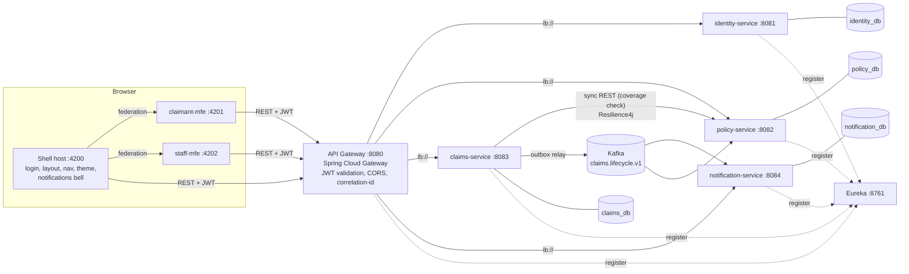
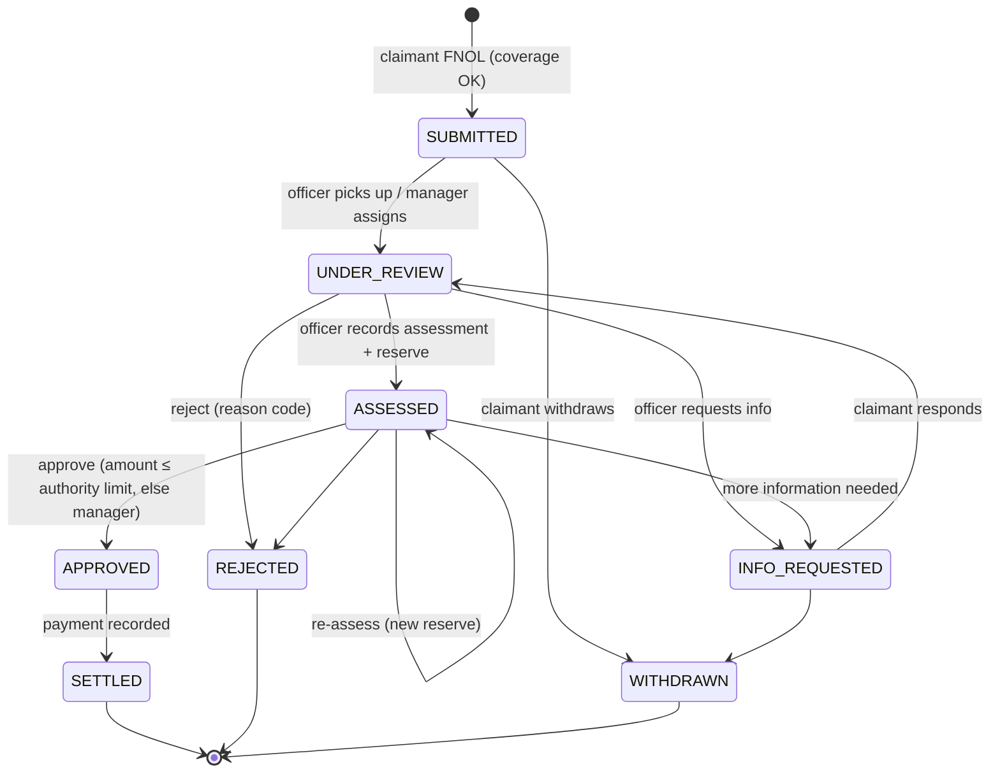
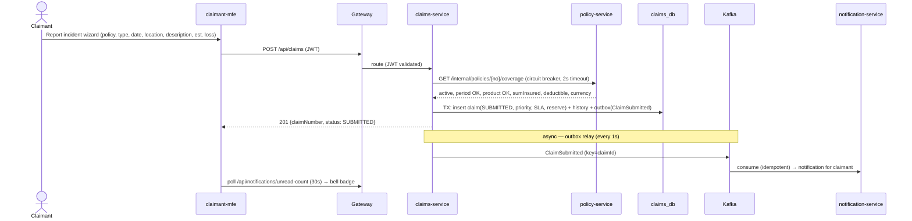

# Intelligent Claims Management Platform — Architecture (HLD + LLD)

> Source documents: `V2_FullStack_candidate_assessment_brief - FrontEnd BackEnd.docx`, `Chubb_Weekend_Drive_Java.pptx`
> (rubric slide 08). The `.mp4` could not be processed by the AI tooling and was not used as a requirement source.

---

## 1. Problem summary

APAC motor & property claims across **six markets** are handled by phone/email/spreadsheets.

| Actor | Needs (from brief) |
|---|---|
| **Claimant** | Report an incident (FNOL), track the claim, provide additional info when asked, receive decisions |
| **Claims Officer** | Pick up incoming claims, review/assess, progress to settlement or rejection, see own + team workload/performance |
| **Claims Manager** | Real-time picture of outstanding claims and **liability exposure**; team workload; approves above officer authority |

Single Angular application serves all user types.

### Rubric-driven priorities (135 pts)

| Area | Pts | How this design scores it |
|---|---|---|
| AI collaboration process | 25 | `docs/AI_JOURNAL.md` kept from the first prompt; accepted / challenged / overridden entries |
| Planning, architecture, design | 15 | This document, ADRs (§12), trade-offs stated explicitly |
| Clean architecture | 15 | Layered-by-feature packages, domain state machine free of Spring, SOLID |
| MFE architecture & components | 15 | Angular **Native Federation**: shell host + `claimant` + `staff` remotes + shared lib |
| Data & integration | 12 | DB-per-service, Flyway, transactional outbox → Kafka, idempotent consumers |
| Service & API design | 10 | Intent-based command endpoints, RFC 7807 errors, OpenAPI per service |
| Backend tests | 8 | Domain unit tests, `@WebMvcTest` + security, Testcontainers/Embedded Kafka integration |
| State mgmt / data flow | 8 | Signal-based stores per feature, unidirectional flow, typed API layer |
| Theming / a11y / UX | 8 | Angular Material M3 tokens, light/dark, WCAG AA contrast, keyboard + ARIA |
| Frontend tests | 7 | Vitest component/store tests, Playwright e2e for the two golden paths |
| Backend / frontend completeness | 5 + 7 | End-to-end flows in §8 working via `docker compose up` |

---

## 2. High-level architecture



### Services and boundaries

| Service | Type | Owns | Why it is its own service |
|---|---|---|---|
| **claims-service** | Business (core) | Claim aggregate, lifecycle state machine, info requests, assessments, decisions, internal notes, workload & exposure read models | The core domain; highest change rate; its data is the system of record for liability |
| **policy-service** | Business | Policies, coverage (sum insured, deductible, period), paid-to-date against policy | Different lifecycle (underwriting), different owners; claims needs a *read* of coverage, not ownership |
| **notification-service** | Business | Per-user in-app notifications (claimant + staff), delivery log | Pure downstream consumer; must never block or fail a claim transaction |
| identity-service | Platform | Users, roles, credentials, JWT issuance | Security concern, swappable for Keycloak/Azure AD later (ADR-005) |
| api-gateway | Platform | Routing, edge auth, CORS, `/internal/**` blocking | Single origin for the SPA |
| discovery-server | Platform | Eureka registry | Required by stack; enables `lb://` routing |

**Deliberately not split out:** documents/attachments (out of scope, ADR-009), assessment as a separate service (it shares the claim's consistency boundary — splitting would force distributed transactions over a single state machine).

---

## 3. Synchronous vs event-driven (the "REST or Kafka" decision)

| Interaction | Mechanism | Reason |
|---|---|---|
| UI ↔ any service | REST via gateway | User waits for an answer; needs validation errors immediately |
| FNOL → **coverage check** (claims → policy) | **Sync REST** (load-balanced `RestClient`, Resilience4j circuit breaker + timeout) | Claimant must be told *now* if the policy is inactive / incident outside period / wrong product. Result is **snapshotted onto the claim** so later reads never call policy-service |
| Claim lifecycle changes → notifications | **Kafka** | Fire-and-forget; notification outage must not fail a claim decision |
| Claim settled → policy paid-to-date | **Kafka** | Eventual consistency is acceptable; decouples policy from claim workflow |
| Manager assigns a claim to another officer (claims → identity) | **Sync REST** `GET /internal/users/{id}` (circuit breaker) | The assignee must be a real, active claims user *before* the claim is changed. Self pick-up needs no call: the officer's id and name come from their JWT |
| Workload / exposure dashboards | REST queries on claims_db | Same consistency boundary; no need for a separate projection at this scale (ADR-007) |

**Reliability:** claims-service writes state change **and** an `outbox_event` row in one DB transaction; a scheduled relay publishes to Kafka (`acks=all`, idempotent producer) and marks rows sent. Consumers are **idempotent** (`processed_event` table keyed by `eventId`) and use `DefaultErrorHandler` with retries → `claims.lifecycle.v1.DLT`.

Topic `claims.lifecycle.v1`, **key = claimId** → per-claim ordering guaranteed within a partition.

---

## 4. Domain model (claims-service)

### 4.1 Claim state machine



Implemented as a pure-Java `ClaimStatus` enum with an allowed-transition table plus guard methods on the `Claim` aggregate
(**State pattern**). Rule failures throw `ClaimRuleException` with a kind that the web layer maps to HTTP:
`INVALID_TRANSITION` / `STALE_VERSION` → 409, `NOT_PERMITTED` → 403, `RULE_VIOLATION` → 422.
`ClaimStatusTest` checks all 64 status pairs against the table.

Further rules enforced by the aggregate: only the assigned officer or a manager may act; amounts cannot exceed
sum insured − deductible; a DENIED assessment must recommend 0 and cannot be approved; a claim returns to review only
when *all* open questions are answered; withdrawing cancels open questions.

**Authority limits** (configurable): `CLAIMS_OFFICER` may approve up to the USD-equivalent of 25,000; above that only `CLAIMS_MANAGER`.

### 4.2 Entities

```mermaid
erDiagram
  CLAIM ||--o{ CLAIM_STATUS_HISTORY : "timeline"
  CLAIM ||--o{ INFO_REQUEST : "asks"
  CLAIM ||--o{ CLAIM_NOTE : "internal"
  CLAIM ||--o| ASSESSMENT : "latest"
  CLAIM {
    uuid id PK
    string claim_number UK "CLM-SG-2026-000123"
    string policy_number
    uuid claimant_id
    string claim_type "MOTOR|PROPERTY"
    string market "SG|HK|AU|MY|TH|ID"
    string currency
    date incident_date
    string incident_location
    text description
    decimal estimated_loss
    decimal sum_insured_snapshot
    decimal deductible_snapshot
    decimal reserve_amount "outstanding liability"
    decimal approved_amount
    decimal paid_amount
    string payment_reference
    string status
    string priority "LOW|MEDIUM|HIGH"
    uuid assigned_officer_id
    string rejection_reason_code
    timestamp sla_due_at
    timestamp submitted_at
    timestamp closed_at
    timestamp updated_at
    bigint version "optimistic lock"
  }
  CLAIM_STATUS_HISTORY { uuid id PK; uuid claim_id FK; string from_status; string to_status; uuid actor_id; string actor_role; text comment; timestamp occurred_at }
  INFO_REQUEST { uuid id PK; uuid claim_id FK; text question; text response; string status "OPEN|ANSWERED"; uuid requested_by; timestamp requested_at; timestamp responded_at }
  CLAIM_NOTE { uuid id PK; uuid claim_id FK; uuid author_id; text body; timestamp created_at }
  ASSESSMENT { uuid id PK; uuid claim_id FK; string liability "ACCEPTED|PARTIAL|DENIED"; decimal recommended_amount; decimal reserve_amount; text findings; uuid assessor_id; timestamp assessed_at }
  OUTBOX_EVENT { uuid id PK; string aggregate_id; string event_type; jsonb payload; timestamp created_at; timestamp published_at }
```

Other services:

* **identity_db** — `app_user(id, email UK, password_hash bcrypt, full_name, role, market, active)`
* **policy_db** — `policy(policy_number PK, holder_user_id, product, market, currency, sum_insured, deductible, start_date, end_date, status, paid_to_date, version)`, `processed_event(event_id PK)`
* **notification_db** — `notification(id, recipient_user_id, claim_id, claim_number, type, title, message, read_at, created_at)`, `processed_event(event_id PK)`

### 4.3 Liability exposure definition (assumption, ADR-008)

* **Initial reserve at FNOL** = `min(estimated_loss, sum_insured) − deductible` (floor 0).
* **Reserve after assessment** = officer-set `reserve_amount`.
* **Outstanding exposure** = Σ reserve of claims in `SUBMITTED, UNDER_REVIEW, INFO_REQUESTED, ASSESSED, APPROVED`.
* **Paid** = Σ `paid_amount` of `SETTLED`. **Incurred** = outstanding + paid.
* Reported per market in local currency **and** USD via a static FX table in config (no live FX — assumption).
* Broken down by market, claim type, status and age bucket (0–7, 8–30, 31–90, 90+ days).

### 4.4 Triage (Strategy pattern)

`PriorityRule` implementations evaluated at FNOL, highest result wins: estimated loss > USD 50k → HIGH, > USD 15k → MEDIUM;
injury reported → HIGH; property claim mentioning a catastrophe peril (flood, fire, storm, typhoon…) → MEDIUM; default LOW.

**SLA = target date to resolve the claim**, set at FNOL: HIGH 7 days, MEDIUM 14, LOW 21. A claim is *overdue* while
open and past that date. (Changed from the first plan's "first response" SLA: one clock is easier for officers to act
on and for managers to report.)

---

## 5. API design (via gateway `http://localhost:8080`)

All errors are RFC 7807 `application/problem+json` (`type`, `title`, `status`, `detail`, `errors[]`, `correlationId`).
State-changing claim commands carry `expectedVersion` → **409** on concurrent modification (e.g. two officers picking up the same claim).
Commands are **intent-based** (`/approve`, `/reject`) rather than `PATCH status`, so the state machine and authorization are enforced per intent.

### identity-service
| Method | Path | Role |
|---|---|---|
| POST | `/api/auth/login` | public → `{accessToken, expiresIn, user}` |
| GET | `/api/auth/me` | any |
| GET | `/api/users?role=CLAIMS_OFFICER` | MANAGER (assignment dropdown, workload names) |

### policy-service
| Method | Path | Role |
|---|---|---|
| GET | `/api/policies/mine` | CLAIMANT (FNOL policy picker) |
| GET | `/api/policies/{policyNumber}` | owner or STAFF |
| GET | `/internal/policies/{policyNumber}/coverage?incidentDate&claimType&claimantId` | service-to-service only (gateway blocks `/internal/**`) |

### claims-service
| Method | Path | Role | Notes |
|---|---|---|---|
| POST | `/api/claims` | CLAIMANT | FNOL; sync coverage check; 201 + Location |
| GET | `/api/claims/mine` | CLAIMANT | paged, filter by status |
| GET | `/api/claims/{id}` | owner / STAFF | claimant gets a redacted view (no reserve, no notes); non-owner → 404 |
| GET | `/api/claims/{id}/timeline` | owner / STAFF | status history + info requests |
| POST | `/api/claims/{id}/info-requests/{rid}/response` | CLAIMANT owner | INFO_REQUESTED → UNDER_REVIEW when all answered |
| POST | `/api/claims/{id}/withdraw` | CLAIMANT owner | |
| GET | `/api/claims/queue?scope=UNASSIGNED\|MINE\|TEAM&status&market&priority&page&sort` | STAFF | JPA Specifications |
| POST | `/api/claims/{id}/assign` | OFFICER (self) / MANAGER (any officer) | |
| POST | `/api/claims/{id}/info-requests` | STAFF (assignee) | |
| POST | `/api/claims/{id}/assessment` | STAFF (assignee) | liability, recommended amount, reserve, findings |
| POST | `/api/claims/{id}/approve` | STAFF (authority limit) | |
| POST | `/api/claims/{id}/settle` | STAFF | payment reference, paid amount |
| POST | `/api/claims/{id}/reject` | STAFF | reason code + explanation to claimant |
| GET/POST | `/api/claims/{id}/notes` | STAFF | internal only |
| GET | `/api/claims/stats/me` | OFFICER | my open, SLA breaches, closed 30d, avg cycle time |
| GET | `/api/claims/stats/workload` | STAFF | per officer: open by status, SLA breached, closed 30d, avg days to close |
| GET | `/api/claims/stats/exposure` | MANAGER (officers read-only summary) | §4.3 |

### notification-service
| Method | Path |
|---|---|
| GET | `/api/notifications?unreadOnly=true&page` |
| GET | `/api/notifications/unread-count` |
| POST | `/api/notifications/{id}/read` |
| POST | `/api/notifications/read-all` |

Also: `GET /internal/users/{id}` on identity-service (service-to-service, blocked at the gateway). Every claim response
carries `allowedActions` for the current status, so the UI never re-implements the state machine.

**Contract ownership:** each service owns its OpenAPI spec (springdoc, code-first, live at `/v3/api-docs` and
`/swagger-ui.html` on each service). The specs are exported to `contracts/openapi/*.openapi.json`; the Kafka event contract
is `contracts/events/claims.lifecycle.v1.schema.json`.
*Deviation from the plan:* the frontend types in `@icmp/shared` (`api.models.ts`) are written by hand to mirror those
specs instead of being generated with `openapi-typescript`. Generation plus a CI drift check is the first follow-up (ADR-006).

---

## 6. Events (`claims.lifecycle.v1`)

Envelope (in `event-contracts` module, versioned):

```json
{ "eventId": "uuid", "eventType": "ClaimApproved", "schemaVersion": 1, "occurredAt": "2026-11-15T10:00:00Z",
  "claimId": "uuid", "claimNumber": "CLM-SG-2026-000123", "claimantId": "uuid", "assignedOfficerId": "uuid|null",
  "market": "SG", "currency": "SGD", "status": "APPROVED", "actorId": "uuid",
  "data": { "amount": 12000.00, "reason": null, "question": null } }
```

| Event | Produced when | notification-service | policy-service |
|---|---|---|---|
| ClaimSubmitted | FNOL accepted | claimant: "claim received" | — |
| ClaimAssigned | pickup/assign | claimant: "officer assigned"; officer: "assigned to you" (manager assign) | — |
| InfoRequested | officer asks | claimant: action required | — |
| InfoProvided | claimant answers | assigned officer | — |
| ClaimAssessed | assessment | — (internal) | — |
| ClaimApproved | approve | claimant: decision | — |
| ClaimSettled | settle | claimant: payment | **add to `paid_to_date`** |
| ClaimRejected | reject | claimant: decision + reason | — |
| ClaimWithdrawn | withdraw | assigned officer | — |

---

## 7. Security

* identity-service authenticates (BCrypt) and issues a **JWT (HS256, 60 min)** with `sub` (userId), `email`, `name`, `role`, `market`.
* **Gateway** validates the JWT at the edge and rejects `/internal/**` from outside.
* **Every service is also an OAuth2 resource server** (defense in depth / zero trust) — `@PreAuthorize` on endpoints, ownership
  checks in the application layer (claimant reading someone else's claim → **404**, not 403, to avoid ID enumeration).
* Service-to-service call (claims → policy) forwards the caller's token (the coverage endpoint validates `claimantId` matches the policy holder).
* Roles: `CLAIMANT`, `CLAIMS_OFFICER`, `CLAIMS_MANAGER`. Frontend route guards are UX only; the backend is the authority.
* Secrets via env vars (`JWT_SECRET`, DB creds); dev defaults only in `docker-compose` / `application-local`.
* Trade-off: HS256 shared secret is simple; production would use RS256 + JWKS or an IdP (Keycloak / Entra ID) — ADR-005.

---

## 8. Key end-to-end flows

### 8.1 FNOL (claimant reports an incident)



Failure paths: policy inactive / outside period → **422** with field-level problem detail; policy-service down → circuit open → **503** "try again shortly" (claim **not** created — ADR-004: we refuse rather than create unverified claims).

### 8.2 Officer pickup → info request → assessment → decision

```mermaid
sequenceDiagram
  actor O as Officer
  actor C as Claimant
  participant SUI as staff-mfe
  participant CUI as claimant-mfe
  participant CS as claims-service
  participant K as Kafka
  participant NS as notification-service
  participant PS as policy-service
  O->>SUI: Work queue (UNASSIGNED, sorted by SLA/priority)
  SUI->>CS: POST /claims/{id}/assign {expectedVersion}
  CS-->>SUI: 200 UNDER_REVIEW (or 409 if a colleague got it first)
  CS->>K: ClaimAssigned → NS notifies claimant
  O->>SUI: Request info ("upload police report number")
  SUI->>CS: POST /claims/{id}/info-requests → INFO_REQUESTED
  CS->>K: InfoRequested → NS → claimant bell "Action required"
  C->>CUI: Answers on claim detail page
  CUI->>CS: POST .../info-requests/{rid}/response → UNDER_REVIEW
  CS->>K: InfoProvided → NS → officer bell
  O->>SUI: Record assessment (liability, recommended, reserve) → ASSESSED
  O->>SUI: Approve (≤ authority) → APPROVED ; Settle (payment ref) → SETTLED
  CS->>K: ClaimApproved, ClaimSettled
  K->>NS: claimant notified of decision / payment
  K->>PS: paid_to_date += paidAmount (idempotent)
```

> Full step-by-step walkthrough (15 steps, sync vs Kafka per step, table-by-table column changes, failure
> scenarios, project overview): `docs/claims-flow.html`.

### 8.3 Manager dashboard

`GET /stats/exposure` + `GET /stats/workload` → KPI tiles (open claims, outstanding USD, paid USD, SLA breaches),
exposure by market/type table + bar chart, ageing buckets, per-officer workload table; manager can reassign from the team queue.

---

## 9. Backend low-level design

### 9.1 Repository layout (independent services)

Each service is its own Maven project with its own `pom.xml` (parent: `spring-boot-starter-parent` 3.4.5), its own
database, Dockerfile and test suite. There is **no parent build and no shared jar**: the services share only REST
contracts and the event JSON schema. (Changed from the first plan's multi-module build with `platform-commons` and
`event-contracts` modules, see the AI journal, entry 2.)

```
claims-management-platform/
├── discovery-server/        Eureka                                   :8761
├── api-gateway/             Spring Cloud Gateway, JWT, CORS          :8080
├── identity-service/        users, login, JWT issuance               :8081  identity_db
├── policy-service/          policies, coverage, paid-to-date         :8082  policy_db
├── claims-service/          claim lifecycle, queue, dashboards       :8083  claims_db
├── notification-service/    in-app notifications from events         :8084  notification_db
├── frontend/                Angular 22 workspace: shell, claimant, staff, shared   :4200 / :4201 / :4202
├── contracts/
│   ├── openapi/             exported OpenAPI spec of each service
│   └── events/              claims.lifecycle.v1.schema.json (the Kafka contract)
├── infra/postgres/          init script: 4 databases, 4 logins
├── scripts/                 build-all.sh, e2e-smoke.mjs, verify-fresh-stack.sh
├── docker-compose.yml
└── docs/                    ARCHITECTURE.md, IMPLEMENTATION_PLAN.md, AI_JOURNAL.md, claims-flow.html, screenshots/
```

The small cross-cutting package `common/` (JWT resource-server config, RFC 7807 handler, correlation-id filter,
`CurrentUser`) is **copied** into each servlet service. That is a deliberate trade: about 300 lines duplicated, in
exchange for services that build, version and deploy independently. In an organisation it would become a versioned
internal starter published from its own repository.

### 9.2 Package structure (claims-service; the others follow the same shape)

```
com.icmp.claims
├── claim/
│   ├── api/                ClaimantClaimController, StaffClaimController, ClaimReadController, ClaimRequests (validated records)
│   ├── application/        ClaimCommandService, ClaimQueryService, ClaimCommands, ClaimViewMapper
│   │   ├── port/           PolicyCoveragePort, StaffDirectoryPort, EventOutboxPort      (what the use cases need)
│   │   └── view/           ClaimViews (read models; staff-only fields are null for claimants)
│   ├── domain/             Claim (aggregate), ClaimStatus (transition table), InfoRequest, Assessment, ClaimNote,
│   │   │                   ClaimStatusHistory, AuthorityPolicy, CurrencyConverter, ClaimDomainEvent, ClaimRuleException
│   │   └── triage/         PriorityRule, HighValueRule, InjuryRule, CatastropheKeywordRule, TriagePolicy
│   └── infrastructure/
│       ├── persistence/    ClaimRepository, ClaimSpecifications, ClaimFigures (dashboard projection)
│       ├── messaging/      OutboxEvent, OutboxEventWriter (EventOutboxPort), OutboxRelay, KafkaTopicConfig
│       └── client/         PolicyCoverageRestAdapter, StaffDirectoryRestAdapter (circuit breakers), RestClientConfig
├── stats/                  StatsController, StatsService, StatsViews (exposure, workload)
├── config/                 DomainConfig (wires domain services), ClaimsProperties, StaticFxRateConverter
└── common/                 security/, web/, error/
```

Pragmatic note: JPA annotations live on the domain aggregate (one model). The alternative, separate domain and persistence
models with mappers, doubles the code for little gain at this size. The domain has no Spring dependencies and is unit
tested without a container (`ClaimTest`, `ClaimStatusTest`, `TriagePolicyTest`).

### 9.3 Design patterns and SOLID

| Pattern | Where |
|---|---|
| State (transition table) | `ClaimStatus` + `Claim.transition()` |
| Strategy | `PriorityRule`s (triage), `NotificationTemplates` per event type, `NotificationChannel` (in-app / email stub) |
| Ports and adapters | `PolicyCoveragePort` ← `PolicyCoverageRestAdapter`, `StaffDirectoryPort` ← `StaffDirectoryRestAdapter`, `EventOutboxPort` ← `OutboxEventWriter` |
| Domain events | `Claim` records `ClaimDomainEvent`s; the application layer drains them into the outbox |
| Transactional Outbox | `OutboxEventWriter` (same TX) + `OutboxRelay` (scheduled publisher) |
| Idempotent Consumer | `processed_event` in notification-service and policy-service |
| Tolerant Reader | each consumer maps only the event fields it needs (`ClaimEvent`, `ClaimLifecycleMessage`) |
| Specification | `ClaimSpecifications` for queue filters |
| Optimistic locking | `@Version` + `expectedVersion` on commands |
| Circuit Breaker + time limiter | Resilience4j around both outbound REST calls |
| API Gateway, Service Registry, DB-per-service | platform |

SRP: claimant vs staff controllers; command vs query services (light CQRS). OCP: new triage rule = new bean. DIP: application
layer depends on ports, not Kafka/HTTP.

### 9.4 Cross-cutting

* Flyway migrations per service; demo data in versioned migrations (`V2__seed_*`), users seeded by `DemoUserSeeder` (BCrypt).
* Optimistic locking (`@Version`), `expectedVersion` on commands.
* `X-Correlation-Id` generated at the gateway (or by the browser), put in the logging MDC by every service, forwarded on
  service-to-service calls and returned in every problem detail.
* Actuator health/readiness; Docker healthchecks gate start order.
* springdoc OpenAPI UI per service.

---

## 10. Frontend design (Angular 22 + Native Federation v4)

```
frontend/projects/
├── shell/      host (:4200): login, layout + role-based nav, notification bell (polling store), theme toggle,
│               loads a remote per role from public/federation.manifest.json; fallback page if a remote is down
├── claimant/   remote (:4201) exposes ./routes: My claims, Report an incident (3-step wizard), Claim detail
│               (progress tracker, decision banner, answer questions, withdraw, history)
├── staff/      remote (:4202) exposes ./routes: Work queue (tabs, filters, paging, sorting, pick-up), Claim workspace
│               (details, cover, questions, assessments, action panel, notes, history), Dashboard (exposure, workload)
└── shared/     @icmp/shared — federation singleton: API types, typed API clients, AuthStore, auth interceptor,
                role guards, problem-detail messages, status/priority chips, timeline, pipes, design tokens (_theme.scss)
```

* **Two user types, one codebase:** the shell reads the role from the session and lazy-loads only that user's remote
  (`/claimant/**` or `/staff/**`, guarded by `roleGuard`). Each remote also runs on its own dev server.
* **Shared singletons:** Angular, Material and `@icmp/shared` are shared as singletons, so the shell and the remotes use
  one `AuthStore` instance (one login).
* **State:** one signal store per feature, provided at page level (`MyClaimsStore`, `ClaimDetailStore`, `QueueStore`,
  `WorkspaceStore`, `DashboardStore`, shell `NotificationStore`). Stores expose read-only signals and intent methods;
  pages bind to them; `ActionPanelComponent` is purely presentational (inputs and outputs only).
* **Async UX:** after every command the store takes the server's response as the new state and refreshes the history.
  A 409 reloads the claim and tells the officer why. Notifications are polled every 30 s and when the tab regains focus.
* **Theming and a11y:** Material 3 theme plus app tokens using CSS `light-dark()`; follows the OS with a 3-way toggle.
  Status is shown as icon plus text, never colour alone. There is a skip link, labelled fields and visible focus, and
  `role="alert"`/`role="status"` for async results.
* **Federation config notes:** Material and CDK ship Node-only schematics, which must be excluded with `skip` in each
  `federation.config.mjs`, or the shared bundle fails to build.

## 11. Assumptions

1. Six markets assumed **SG, HK, AU, MY, TH, ID** with local currencies; static FX to USD for reporting.
2. Claimants are existing policyholders; no self-registration (seeded users). Policies seeded per claimant.
3. Document/photo upload is out of scope; info requests are text answers (stretch: attachments in object storage).
4. Payment is recorded (reference + amount), not executed — no payments integration.
5. One team per market is not modelled; "team" = all officers (manager sees all; filter by market).
6. Officer authority limit USD 25k; above that a manager must approve.
7. Notifications are in-app only; email/SMS is a logged stub behind a `NotificationChannel` strategy.
8. Single Postgres **instance** with four isolated databases/users locally (logical DB-per-service); production would be separate instances.
9. Target Java 17 bytecode (`--release 17`); local dev JDK is 24, Docker images use Temurin 17.
10. A manager is also allowed to act on any claim (assess, approve, reject); officers only on claims assigned to them.
11. Sessions are kept in sessionStorage (closing the tab signs out). Tokens last 60 minutes and there is no refresh token.

---

## 12. Architecture decisions

| # | Decision | Alternatives rejected |
|---|---|---|
| 001 | 3 business services (claims, policy, notification) + identity | single monolith (doesn't show boundaries); splitting assessment from claims (one state machine → distributed TX) |
| 002 | REST for queries/commands needing an answer; Kafka for lifecycle facts | Kafka request/reply for coverage (latency, complexity) |
| 003 | Native Federation MFEs (shell + 2 remotes by user type) | one SPA with lazy modules (doesn't meet MFE rubric); Webpack Module Federation (Angular now esbuild-based) |
| 004 | Coverage check failure → refuse FNOL (503) | accept as "PENDING_VERIFICATION" (more states, better availability — noted as next step) |
| 005 | HS256 JWT from own identity-service | Keycloak (heavier local setup); RS256/JWKS (next step) |
| 006 | Code-first OpenAPI, specs exported to `contracts/openapi`; frontend types hand-written for now (generation is the next step) | contract-first (slower in a sprint) |
| 007 | Dashboards query claims_db directly | separate CQRS analytics service on Kafka (premature at this scale) |
| 008 | Reserve-based exposure definition §4.3 | estimated-loss only (overstates) |
| 009 | Transactional outbox | direct `kafkaTemplate.send` in TX (dual-write inconsistency) |
| 010 | Independent Maven projects per service, cross-cutting code copied, events shared as JSON Schema | multi-module build with shared `platform-commons` / `event-contracts` jars (couples releases) |
| 011 | Integration tests on real PostgreSQL (Testcontainers) and embedded Kafka | H2 (would hide PostgreSQL-specific SQL such as `jsonb`, sequences, partial indexes) |
